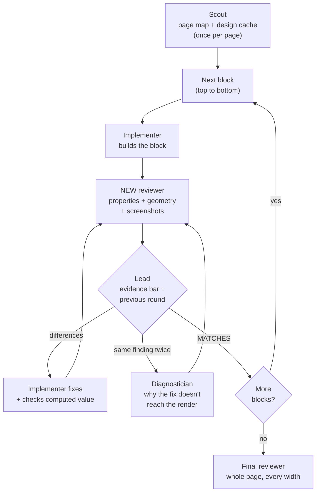

# Iterative Layout Development

**A Claude Code skill for pixel-perfect Figma-to-code layout.** Your coding agent builds the page one block at a time, and a *fresh* agent checks each block against the Figma design — by numbers, not by eye — until nothing differs. Then the next block.

> AI coding agents are good at logic and bad at layout. The page "looks about right", but the padding is 6px off, the blur behind the photo is gone, the font is a fallback, and the icon is squashed. You end up fixing CSS by hand.

This skill fixes that, and it's been used to ship real production marketing pages where every block was closed with a `MATCHES` verdict.

[Русская версия](README.ru.md)

---

## Why agents lay out badly

Not because they can't write CSS. Because **they check their own work, by looking at a screenshot.** The author sees what they meant to build, not what got rendered. And a screenshot hides exactly the things that make a design feel right: 2px of spacing, a semi-transparent backdrop, a shadow that isn't black, a hover transition.

So this skill takes self-review away:

- **The implementer never judges its own block.** A new reviewer agent with a clean context does, every round. It doesn't see the implementer's report, the diff, or what was fixed before — only the design and the rendered page.
- **The reviewer compares numbers.** Figma values (`get_design_context`, `get_metadata`) against the browser's **computed styles** (`getComputedStyle`) and **geometry** (`getBoundingClientRect`, relative to the block root), element by element. Screenshots are the third layer, for overlap and clipping — not the main one.
- **The loop runs until the reviewer says `MATCHES`.** "Almost the same" is a mismatch.

## How it works



| Role | Does | Never does |
|---|---|---|
| **Scout** | Reads the Figma frame and your project once per page, writes the page map, caches design data, downloads assets, lists conflicts with your design system | Build or review |
| **Implementer** | Builds one block, fixes findings | Declare a block done |
| **Reviewer** | New agent every round; measures both sides, returns a table of differences or `MATCHES` | Edit code, read the implementer's report |
| **Diagnostician** | Called when the same finding comes back twice: explains which rule wins and why | Close the block |
| **Lead** | Your main session: runs the loop, filters findings, keeps the rejected list | Overrule the reviewer "by eye" |

A finding is only valid with numbers:

| element | property | design (value · source) | ours (computed) | where in code |
|---|---|---|---|---|
| `.hero .cta` | `y` from block root | `412` · metadata 12:351 | `418` | `hero.css:17` |

## What's inside

- **Three-layer review**: properties, geometry, screenshots — each catches what the others miss.
- **A page map** written by the scout, so the 10th block doesn't rediscover the fonts and tokens again.
- **A design cache** — Figma's local MCP server has a daily request limit; the skill reads numbers from the cache and only goes to Figma for screenshots.
- **A rule for loops that don't converge**: same finding twice → diagnostician; regressions two rounds in a row → replace the implementer.
- **Conflict handling**: when "pixel-perfect" and your design system disagree (a 13px gap vs. a 12/16 scale), the agent doesn't decide — it brings options to you.
- **Lessons from production**, written into the checklist: a global `svg { max-width: 100% }` squashing icons, Figma not reporting clipping in `design_context`, accepted offsets that would otherwise show up as findings in every block below.
- **`scripts/figma_mcp.py`** — a tiny client for the Figma desktop MCP server (standard library only), for projects where Figma isn't registered as an MCP server.

## Install

```bash
git clone https://github.com/EvgeniiMeleshkov/iterative-layout-development.git
# all projects:
cp -r iterative-layout-development/skills/iterative-layout-development ~/.claude/skills/
# or one project:
cp -r iterative-layout-development/skills/iterative-layout-development <your-project>/.claude/skills/
```

The skill is picked up in the next Claude Code session.

## Use

In a Claude Code session:

- `let's do iterative layout development, one page: <name>`
- `let's do iterative layout development, everything` — all frames of the design
- `let's do iterative layout development, block <name>`

or `/iterative-layout-development`.

## Requirements

- **Claude Code** with subagents — the "fresh reviewer" is a new subagent each round.
- **Figma desktop** with the Dev Mode MCP server enabled and your design file open. Work on a copy in your drafts (Duplicate to your drafts).
- **A browser tool** the agent can drive: Claude in Chrome, Playwright MCP or similar — to run JS and take screenshots.
- **Your dev server** (or a static render) running, plus an `iframe` wrapper of the frame's width served from the same origin.
- **Python 3** for the Figma client.

Tell the agent about your stack in `CLAUDE.md` — tokens, components, where assets go, where to write scars (notes about past mistakes). The skill reads it; if it's empty, it asks once.

## Cost, and when not to use it

Be honest with yourself about this:

- **It's not cheap.** Every round is a new agent with screenshots, and there's no round limit. A page of 15 blocks means dozens of agent runs. Running 4–5 reviewers in parallel once burned through Figma's daily MCP limit in a few hours — hence the cache and the "2–3 reviewers at a time" rule.
- **It pays off where pixels matter**: landing pages, marketing sites, a design handed off by a designer who will check.
- **It's overkill for product UI built from a component library** (shadcn, Tailwind UI, your own kit), where following the design system matters more than matching a mockup to the pixel.

## FAQ

**Does it work without Figma?** The process is design-tool agnostic, but the instructions for pulling numbers are written for the Figma desktop MCP server. Adapting it to another source means replacing the "Design source" section.

**Why not a pixel-diff tool?** A pixel diff tells you *that* something is off, not *which property in which file*. The reviewer here returns `element · property · design value · our value · file:line`, so the fix lands on the first try. A pixel diff could be a useful extra layer — contributions welcome.

**Does it work with Cursor / Codex / other agents?** It's written for Claude Code (skills + subagents). `SKILL.md` is plain Markdown, so the process can be adapted to any agent that can spawn a separate reviewer with a clean context.

## Contributing

Issues and PRs are welcome — especially new entries for the artifact checklist (things agents keep losing) and adapters for other design sources.

## License

MIT — see [LICENSE](LICENSE).

## Author

Built by **Evgenii Meleshkov** — full-stack engineer shipping products through AI agent pipelines.
[GitHub](https://github.com/EvgeniiMeleshkov) · [LinkedIn](https://www.linkedin.com/in/evgenii-meleshkov-b0b81024a)

If this saved you from fixing CSS by hand, a ⭐ helps others find it.
